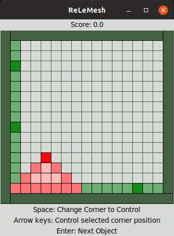

# ReLeMesh

Mesh generator based on Deep Reinforcement Learning.

Mesh generation subdivides a continuous domain into a discrete representation (see [wiki](https://en.wikipedia.org/wiki/Mesh_generation)). This is a prerequisite for numerical simulations of fluid dynamics and other physical phenomena. Producing a high-quality mesh is time-consuming and usually requires expert knowledge — ReLeMesh trains an agent to do it automatically.

## How it works

A Double DQN agent learns to place triangular mesh elements one at a time inside a 2D domain. The domain boundary is shown as green pixels; the element currently being shaped is shown in red.

At each step the agent chooses one of 9 actions:

| Actions | Effect |
|---------|--------|
| 0–7 | Move the triangle apex in 8 directions |
| 8 | Commit the current element and spawn the next one |

The agent is rewarded for covering area efficiently, penalised for overlap, element distortion, and each step taken.



## Prerequisites

- Python 3.10+
- PyTorch 2.0+ (`pip install torch`)
- NumPy (`pip install numpy`)
- tkinter — GUI only (`sudo apt install python3-tk`)

## Quick start

### 1. Train

```bash
cd src
python3 gameTrainingMain.py --use-cpp --episodes 5000
```

Each run saves to a **timestamped subdirectory** automatically, e.g. `./dqn/20260302_143021/`.
That folder contains `checkpoint.pt`, `training_log.csv`, and `config.json`.

For a quick experiment on a smaller problem:

```bash
python3 gameTrainingMain.py --use-cpp --env-size 9 --h-size 64 \
    --pre-train-steps 5000 --annealing-steps 30000 --episodes 2000
```

### 2. Resume training

```bash
python3 gameTrainingMain.py --use-cpp \
    --path ./dqn/20260302_143021 --load-model --episodes 10000
```

Restores weights, optimiser state, epsilon, step count, and env/model config automatically.

### 3. Evaluate

```bash
python3 evaluate.py --episodes 100 --path ./dqn/20260302_143021
```

Runs the trained agent with a greedy policy and reports mean / std / min / max reward.

### 4. Plot training curves

```bash
python3 plot_training.py --path ./dqn/20260302_143021
```

Saves `training_curves.png` in the run directory — reward, episode length, and epsilon over time.

### 5. Replay as a GIF

```bash
python3 replay.py --path ./dqn/20260302_143021 --episodes 3 --fps 6
```

Runs the trained agent greedily and saves `replay.gif`. Blue pixels are placed elements and walls; red/orange is the element currently being shaped.

### 6. Watch the agent in the viewer

```bash
python3 mainUseNetworkInViewer.py
```

Opens a tkinter window showing the partial 15×15 view the agent sees. Press **`q`** to let the network take one step. When the episode ends, a second window shows the full 25×25 result.

### 7. Play it yourself

```bash
python3 MeshEnvViewerGame.py
```

Choose `t` for the triangle environment (same one the agent trains on).

| Key | Action |
|-----|--------|
| Arrow keys | Move the triangle apex |
| Enter | Commit element, spawn next |
| Space | Switch which corner you control |
| 0–8 | Direct action number |

### 8. Run unit tests

```bash
python3 -m pytest unitTest/MesherEnv_test.py -v
```

## Training options

All hyperparameters are configurable from the command line:

```
python3 gameTrainingMain.py --help
```

Key flags:

| Flag | Default | Description |
|------|---------|-------------|
| `--env-size` | 15 | Grid size. Use 9 for quick experiments |
| `--h-size` | 512 | Final conv layer channels (model capacity) |
| `--lines` | 4 | Boundary lines per side — fewer = simpler problem (Python env only) |
| `--use-cpp` | off | Use the C++ environment backend (~4–5× faster) |
| `--episodes` | 5000 | Number of training episodes |
| `--gamma` | 0.92 | Discount factor |
| `--lr` | 1e-4 | Adam learning rate |
| `--start-epsilon` | 0.6 | Initial exploration rate |
| `--end-epsilon` | 0.01 | Final exploration rate |
| `--annealing-steps` | 600000 | Env steps over which epsilon decays |
| `--pre-train-steps` | 100000 | Random steps before gradient updates begin |
| `--batch-size` | 160 | Replay batch size |
| `--tau` | 0.001 | Target network soft-update rate |
| `--seed` | None | Random seed for reproducibility |
| `--device` | auto | Force `cpu` or `cuda` |
| `--path` | `./dqn` | Base directory; run subdirs are created automatically |
| `--load-model` | off | Resume from checkpoint in `--path` |
| `--log-csv` | `training_log.csv` | CSV filename within the run directory |

Example — quick experiment on a small problem:

```bash
python3 gameTrainingMain.py --use-cpp --env-size 9 --h-size 64 \
    --episodes 2000 --pre-train-steps 5000 --annealing-steps 30000 \
    --end-epsilon 0.05 --seed 42
```

## Training log output

Every run prints periodic status lines and writes two files to its run directory.

### Console output

```
10:04:12 Run dir: ./dqn/20260302_100412
10:04:12 Using device: cuda
10:04:12 Using C++ environment backend.
...
10:05:44 Checkpoint saved | episode=1000 | e=0.3241 | total_steps=87432 | env_time=12.4s | net_time=38.1s
10:06:01 Avg reward (last 500, ep 1500): -0.2314  Δ+0.0812
```

| Field | Meaning |
|-------|---------|
| `episode` | Episode number at the checkpoint |
| `e` | Current epsilon (exploration rate) |
| `total_steps` | Cumulative environment steps across all episodes |
| `env_time` | Wall time spent inside `env.step()` since the last log |
| `net_time` | Wall time spent on forward passes and gradient updates |
| `Avg reward (last 500)` | Rolling mean reward; `Δ` is the change since the previous report |

`net_time` is near zero during `pre_train_steps` (random actions only) and rises sharply once gradient updates begin.

### `training_log.csv`

One row per episode:

| Column | Description |
|--------|-------------|
| `episode` | Episode index (0-based) |
| `total_steps` | Cumulative env steps at end of episode |
| `reward` | Total undiscounted reward for the episode |
| `steps` | Number of steps taken in the episode |
| `epsilon` | Exploration rate at end of episode |

### `config.json`

Saved once at the start of each new run. Records all structural and hyperparameter settings so runs are fully reproducible and can be resumed without re-specifying flags:

```json
{
  "env_size": 9,
  "h_size": 64,
  "use_cpp": true,
  "lines": 4,
  "gamma": 0.92,
  "lr": 0.0001,
  ...
}
```

## Project structure

```
src/
├── gameTrainingMain.py          # Training entry point
├── evaluate.py                  # Greedy evaluation (mean/std/min/max reward)
├── plot_training.py             # Plot reward, episode length, epsilon from CSV
├── replay.py                    # Run trained agent and save replay GIF
├── benchmark.py                 # Python vs C++ environment speed comparison
├── mainUseNetworkInViewer.py    # Viewer with trained agent (requires tkinter)
├── MeshEnvViewerGame.py         # Interactive manual-play viewer
├── MeshEnvViewer.py             # Tkinter viewer base class
├── Networks/
│   └── BasicQNetwork.py         # Double DQN, experience buffer, processState
├── environments/
│   ├── triMesherEnv.py          # Triangle mesh environment (Python)
│   ├── triMesherEnvCpp.py       # Triangle mesh environment (C++ backend)
│   ├── PartialViewEnv.py        # 15×15 partial observation wrapper
│   ├── AbstractMeshEnv.py       # Base environment class
│   └── Rendering/
│       └── BasicEnvironmentRender.py  # 2D rasteriser
├── gameObjects/                 # Triangle, line, quad primitives
├── worldGenerators/             # Domain boundary generators
└── unitTest/
    └── MesherEnv_test.py        # 24 unit tests
```

## Author

**Rasmus O. Hjort** — [LinkedIn](https://linkedin.com/in/rasmus-o-hjort-b8179289)
